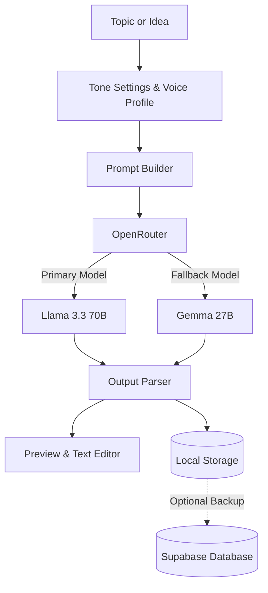

# VoiceTweet

A writing tool that learns your personal writing style and generates tweets, threads, and short posts that sound like you instead of generic AI.

---

## Overview

Most AI writing tools produce generic, repetitive text that is easy to spot. VoiceTweet helps you define your vocabulary, sentence length, opinions, and words you avoid, so generated posts match how you actually write.

---

## Features

### 1. Voice Profiling
- **Writing questionnaire:** Answer 10 questions about how you communicate, your usual phrasing, and topics you focus on.
- **Sample profiles:** Quickly test different writing styles (such as founder, marketer, or writer) to see how the tone adapts.
- **Tone controls:** Adjust sliders for formality, energy, boldness, and humor.

### 2. Post and Thread Preview
- **Post preview:** See how your post looks before sharing it, including author name, handle, and formatted text.
- **Thread viewer:** Automatically formats and connects multi-part threads.
- **Character count:** Real-time character counter with limit warnings and a quick link to post directly to X.

### 3. Model Fallbacks
- Sends requests through OpenRouter with fallback models in case the primary model is busy or unavailable.

### 4. Feed and Pattern Analysis
- Explore current topics in your niche.
- Save high-performing posts to reference patterns for future drafts.

### 5. Local Storage and Cloud Backup
- Saves drafts and settings directly to browser local storage so the app works quickly offline.
- Optionally syncs data to Supabase when you connect an account.

---

## Architecture



---

## Getting Started

### 1. Installation
```bash
git clone https://github.com/Noskinpain/voicetweet.git
cd voicetweet
npm install
```

### 2. Environment Variables
Copy the example environment file:
```bash
cp .env.example .env.local
```

Add your keys to `.env.local`:
```env
# Supabase (optional, for cloud backup)
NEXT_PUBLIC_SUPABASE_URL=https://your-project.supabase.co
NEXT_PUBLIC_SUPABASE_ANON_KEY=your-anon-key

# OpenRouter (required for generation)
OPENROUTER_API_KEY=your-key-here
```

### 3. Supabase Table Setup (Optional)
If you want to enable cloud backup, create this table in your Supabase SQL editor:
```sql
create table if not exists account_data (
  email text primary key,
  name text,
  handle text,
  voice_profile jsonb,
  history jsonb,
  scheduled jsonb,
  trained_tweets jsonb,
  updated_at timestamp with time zone default timezone('utc'::text, now())
);
```

### 4. Run Locally
```bash
npm run dev
```
Open [http://localhost:3000](http://localhost:3000) in your browser.

---

## Tech Stack

- Next.js 16 (App Router)
- React 19
- TypeScript
- Tailwind CSS
- OpenRouter API
- Supabase

---

## License
MIT
